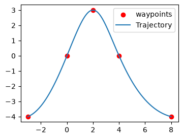

# HW4 — Convex Optimization, KKT & Min-Snap Trajectories

Full writeup: [`Controls_HW_4-1.pdf`](Controls_HW_4-1.pdf).

## Topics covered

1. **Convexity:** strict convexity of `‖x‖²` from its Hessian, convexity of set intersections and of the set of nonnegative polynomials, and closure of convex functions under nonnegative combinations.
2. **Quadratic programming:** find the closest pair of points between the line `y = −2x + 5` and a box, written as a QP `min ½zᵀHz` with equality and inequality constraints.
3. **Parametric programming:** a minimum-effort problem `min ½Σ‖uᵢ‖²` subject to a terminal-state constraint for the integrator `xₖ₊₁ = xₖ + uₖ`.
   - The KKT conditions force all optimal inputs to be equal.
   - This gives a closed-form `u*(x₀)` and `J*(x₀)` in the active and inactive constraint regions, and the two solutions agree on the boundary.
4. **Min-snap quadrotor trajectories** ([`minsnap.py`](minsnap.py), [`pos_constraints.py`](pos_constraints.py)): the planar quadrotor is differentially flat, so a trajectory can be planned directly in `(y, z)`.
   - **Representation:** piecewise polynomials through the waypoints.
   - **Cost:** the integral of squared snap, evaluated in closed form as a block-diagonal quadratic `vᵀHv` (built with Kronecker products, `C ⊗ I₂`).
   - **Constraints:** waypoint interpolation, plus continuity of derivatives 1–4 at each junction, assembled as linear equality matrices.
   - **Solver:** Drake's OSQP solves the resulting QP.
5. **Lagrangian duality:** weak duality `q(λ) ≤ L(x, λ) ≤ f(x)`, the dual of an inequality-constrained QP (shown to be convex), and `q(λ*) = f(x*)` at a KKT point.

## Results

**Min-snap trajectory** through 5 waypoints, using degree-9 polynomial segments (d = 10 coefficients) and unit segment times:

<p align="center">
  
</p>

## Running the code

```bash
uv sync                                    # from the repo root; installs drake
jupyter notebook min_snap_quadrotor.ipynb  # solve the min-snap QP and plot the trajectory
```
