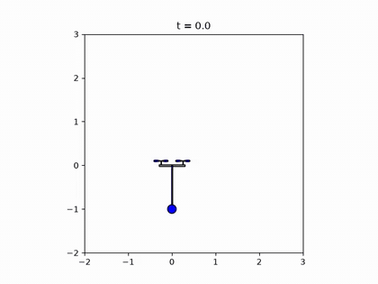
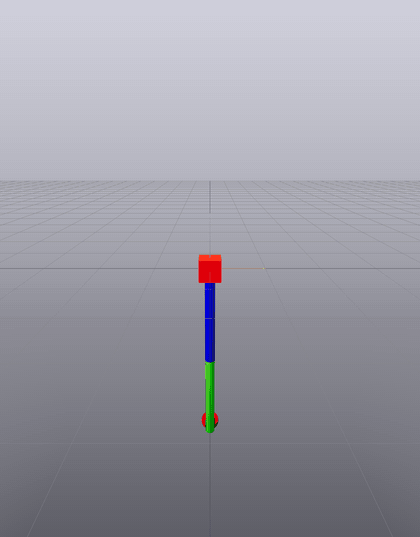

# HW5 — iLQR Swing-Up & Direct-Collocation Arm Throw

Full writeup: [`Controls_HW_5.pdf`](Controls_HW_5.pdf).

## Topics covered

1. **iLQR for a 2D quadrotor with a pendulum** ([`Quadrotor-Swingup-iLQR/`](Quadrotor-Swingup-iLQR/)): derive the iLQR update from a second-order expansion of the Bellman equation. Minimizing the local Q-function gives the affine policy `δu*ₖ = Kₖδxₖ + dₖ` with `Kₖ = −Q_uu⁻¹Q_ux`, `dₖ = −Q_uu⁻¹Q_u`. The value-function recursion is rewritten in the numerically stable form `gₖ = Q_x − KₖᵀQ_uu dₖ`, `Hₖ = Q_xx − KₖᵀQ_uu Kₖ`. [`iLQR.py`](Quadrotor-Swingup-iLQR/iLQR.py) implements:
   - **Backward pass:** starts from the terminal cost's gradient and Hessian, then sweeps `k = N−2, …, 0`, solving with `Q_uu` instead of inverting it.
   - **Forward pass:** rolls out the closed-loop update `uₖ = ûₖ + Kₖ(xₖ − x̂ₖ) + α dₖ` through the full nonlinear dynamics.
   - **Linearization:** symbolic SymPy linearization of the 8-state quadrotor-pendulum model (Lagrangian dynamics), discretized with zero-order hold.

   The swing-up task is encoded only through a quadratic cost toward the goal state `(y, z, θ, φ) = (−0.5, 1.5, 0, π)` at rest. The rotors can't act on the pendulum angle `φ` directly, so the optimizer has to move the quadrotor itself to swing the pendulum up.
2. **Direct collocation** (derivation in the writeup): cubic-spline states and linear-spline inputs, with the spline's endpoint conditions matched to the dynamics. The spline coefficients give the midpoint state `½(xᵢ + xᵢ₊₁) + (Δt/8)(fᵢ − fᵢ₊₁)` and slope `(3/2Δt)(xᵢ₊₁ − xᵢ) − ¼(fᵢ + fᵢ₊₁)`. Requiring the dynamics to hold there gives the collocation constraint `hᵢ = ṡᵢ(Δt/2) − f(sᵢ(Δt/2), ½(uᵢ + uᵢ₊₁)) = 0`.
3. **Planar-arm throwing trajectory** ([`Ball-throw-Direct-Collocation/`](Ball-throw-Direct-Collocation/)): a 2-link arm throws a ball to land at least a distance `d` away, with minimum control effort `∫‖u‖² dt`. The problem is set up as a Drake `MathematicalProgram`:
   - **Collocation constraints:** [`dynamics_constraints.py`](Ball-throw-Direct-Collocation/dynamics_constraints.py).
   - **Bounds:** on torque, joint position and joint velocity.
   - **Projectile landing constraint:** written in terms of the release state and a free landing time `t_land` ([`kinematic_constraints.py`](Ball-throw-Direct-Collocation/kinematic_constraints.py)).
   - **Cost:** a trapezoidal effort cost, in [`find_throwing_trajectory.py`](Ball-throw-Direct-Collocation/find_throwing_trajectory.py).

## Results

**iLQR quadrotor-pendulum swing-up.** The quadrotor starts at rest at the origin with the pendulum hanging down. iLQR finds a 4 s (N = 200, dt = 0.02) trajectory that swings the pendulum up and settles with it balanced upright over the quadrotor:

<p align="center">
  
</p>

**Arm throw, d = 15 m.** At d = 5 m the torque limit (20 N·m) and velocity limit (15 rad/s) are already near binding, and larger distances return `kInfeasibleConstraints`. Three changes made d > 10 m reachable:
- constraining the release height to the top of the arm's reach (1.99–2 m),
- relaxing the landing constraint from `= d` to `≥ d`,
- seeding the initial guess with a fast final shoulder velocity.

Even then, finding a solution can take 10–15 random restarts, and a successful solution is saved for warm-starting later runs. The arm winds up and then whips over the top to release the ball (the animation ends at release):

<p align="center">
  
</p>

## Running the code

```bash
uv sync                                                    # from the repo root; installs drake, sympy, etc.
jupyter notebook Quadrotor-Swingup-iLQR/hw5.ipynb          # iLQR swing-up + animation
jupyter notebook Ball-throw-Direct-Collocation/Arm-Throw.ipynb   # throw trajectory (Meshcat visualization)
```
